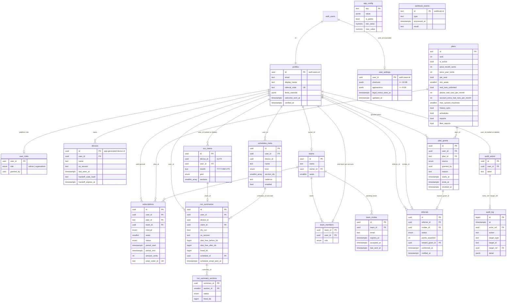
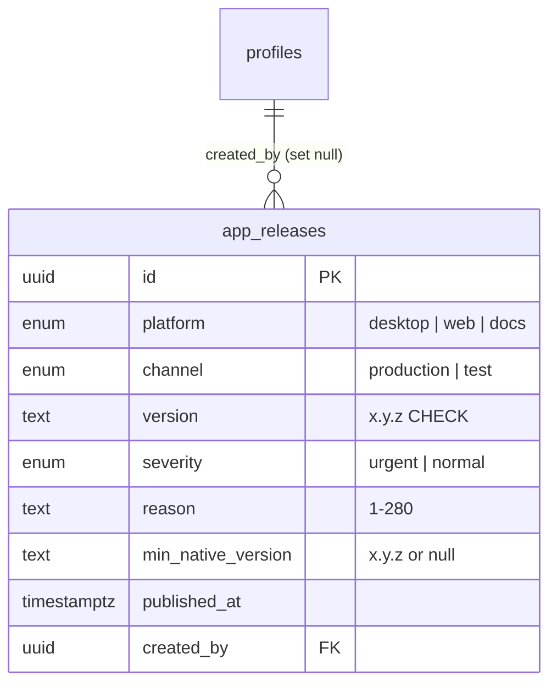

# linux-cleanup database schema

Hosted Supabase Postgres. Drizzle authors the tables and policies (`supabase/schema/*.ts`), and
`drizzle-kit generate` writes them offline into `supabase/migrations/`. Functions, triggers,
grants and seed rows are custom migrations in the same folder. The Supabase CLI is the only
applier (`supabase db push`). Every migration has a reviewed companion in `supabase/rollbacks/`
that is never applied automatically.

**Last updated:** 2026-10-30. The first schema has not been applied, because the hosted project
does not exist yet.

## Diagram

## Tables

| Table | Why it exists | Owner column, RLS shape | Rows expected |
|---|---|---|---|
| `profiles` | One row per auth user, including anonymous devices. A trigger on `auth.users` creates it. `verified_at` records when the account first became a verified, non-anonymous (Google) account. The auth triggers stamp it once, and the referral window (30 days) is measured from it. | `id`. Signed-in users can select and update their own row. The only client-writable column is `display_name`. | One per install, plus accounts |
| `user_settings` | Synced preferences of a signed-in account: rebindable shortcuts, appearance axes and the account half of the legal-notice flag (`legal_notice_seen_at`). Anonymous devices keep these local. | `user_id`. Non-anonymous users can select, insert and update their own row; there is no DELETE grant, and account deletion cascades the row. Column grants: insert `(user_id, shortcuts, appearance, legal_notice_seen_at)`, update `(shortcuts, appearance, legal_notice_seen_at)`. The size and object-type CHECKs live on the row. | One per account |
| `user_roles` | The platform staff ladder (two rungs). No row means an ordinary user. | `user_id`. Users can select their own row. Only the seed trigger and service-role SQL write it. | 2 or more |
| `devices` | A computer, keyed by the random id the app keeps locally. It is bound to one user: a different caller registering it gets `device_owned` (42501). The anonymous-to-Google link keeps the same user id, so it passes. Any other move, such as signing in to an existing Google account on this computer or signing out, needs a one-time hand-over: the current owner calls `device_handoff_begin(device_id)` and gets a code valid for 15 minutes (only its sha256 is stored). The next session calls `device_handoff_complete(device_id, code)`. Each hand-over is audited as `device.handoff`. | `user_id`. The owner can select it, rename it and delete it ("Forget"). Anonymous sessions get these rights too, because they are device-scoped. | One per install |
| `plans` | The plan registry. A tier is a row, and its limits and prices are admin fields. | Anon and authenticated can select active rows. | 3 |
| `subscriptions` | One row per **paid order** (one paid period). Renewals add a row. A returned payment ends that row only. | `user_id`. Signed-in users can select their own rows. Only the webhook SQL writes. | Small |
| `plan_grants` | Plans given without payment (admin, referral) with provenance: source, `granted_by`, reason and window. Grants extend and never overwrite. | `user_id`. Signed-in users can select their own rows. Admin SQL and the referral trigger write. | Small |
| `run_claims` | One row per real run, counted per device and per account per UTC month. It has no FK on `device_id`, so the device pool survives account deletion with `user_id` nulled. | `user_id`. Users can select their own rows. Only `claim_run()` writes. | About 30 per active device per month |
| `run_summaries` | Synced receipts as numbers only. **No path or file-name column, ever.** `schedule_id` links a run that came from a synced schedule. `schedule_email_sent_at` makes the "Scheduled run finished" email go out at most once per summary. Both are written only by `schedule_email_claim()`, and the schedule's name and labels are never stored. | `user_id`. Signed-in users can select their own rows. Only `record_run_summary()` writes, and it requires history sync. | Pro users only |
| `run_summary_sections` | Per-section numbers. They form a list, so they get a table and not a JSON array. | Visible through the parent summary's owner. | About 10 per summary |
| `schedules_meta` | Pro sync of schedule specs (what and when). The systemd user timer stays on the computer. | `user_id`. Signed-in users can CRUD their own rows. Insert and update also require `has_feature('schedules')`. | A few per Pro user |
| `teams` | The Team-plan workspace. `seats` comes from the paid order (minimum 3, enforced in SQL). | Members can select it, through `private.my_team_id()`. | Small |
| `team_members` | Seats in use, one team per account. | Members of the same team can select. | At most the seat count |
| `team_invites` | Pending seats. Only a signed-in account whose verified email matches can accept. Creating a team or inviting needs a plan with fleet reports. `last_sent_at` limits the invite email to a new invite, or one re-send per 24 hours. | Team members can select, and so can the invitee (matched by JWT email). | Small |
| `referrals` | The referral ledger. A referral is confirmed only by the verified-email trigger, never by a click. | `referrer_id`. Signed-in users can select their own rows. No client role can INSERT or UPDATE. | Small |
| `app_config` | Admin fields with DB-enforced bounds (a CHECK on `min_value`/`max_value`). | Anon and authenticated can select rows where `is_public` is true. | 6 |
| `audit_actors` | Pseudonymous actor and target rows. Deleting an account anonymises this row and leaves `audit_log` untouched. | Service role only. | One per audited person |
| `audit_log` | Append-only audit trail. No UPDATE, DELETE or TRUNCATE grant for any role, and a trigger refuses those operations even for the owner. | Service role can read. Rows are written by SECURITY DEFINER SQL. | Grows slowly |
| `webhook_events` | Idempotency on the Polar delivery id. | Service role only. | One per delivery |
| `fileshub-project-status-check` | **Platform table, not product data.** FilesHub's keep-alive for this free-tier project: FilesHub inserts, counts and prunes rows so the database is never paused. It holds no user data and is not authored by Drizzle. | RLS on, no policies, so no client role can read or write it; `service_role` only. | A handful, pruned by FilesHub |

## RLS and privilege summary

- RLS is enabled on all 25 tables: the 24 product tables and the platform keep-alive table (live catalog, 2026-11-02). Every predicate wraps `auth.*` in a sub-select. Every list a
  client runs filters on the column its policy reads (`user_id`, `referrer_id`, `team_id`).
- **Anonymous device sessions** carry the `authenticated` role. `private.is_anon()` (the JWT
  `is_anonymous` claim) limits them to device-scoped rows: `devices`, `run_claims` and their
  allowance. Account rows require `private.is_anon() is false`.
- **Grants**: `20261030070904_privileges.sql` revokes ALL (TRUNCATE included) on every table from
  `public`, `anon`, `authenticated` and `service_role`. It then grants back exactly what is needed,
  using column grants for privilege columns (`profiles.display_name`, `devices.name`, the
  `schedules_meta` spec columns). Default privileges in `public` are closed too. Each function also
  gets its own `revoke`, because a Supabase `supabase_admin` default ACL outranks a schema default.
- **No client upserts.** A PostgREST upsert needs UPDATE on every column it sends, even when nothing conflicts. `user_id` on `user_settings` is deliberately not updatable, so an upsert is refused with "permission denied for table user_settings". The client inserts its row once, treats `23505` (row exists) as fine, then updates `shortcuts`, `appearance` or `legal_notice_seen_at`. A trigger bumps `updated_at`.
- **Browser-callable SQL** is limited to seven functions, granted to `authenticated` only:
  `get_allowance`, `claim_run`, `record_run_summary`, `schedule_email_claim`, `device_handoff_begin`,
  `device_handoff_complete` and `export_my_data`. `export_my_data` returns the caller's own data as one JSON object for "Download my data" (the newest 500 summaries and claims). Each re-validates its input and uses `auth.uid()`. All other `public.*` functions (admin, team, billing, referral, deletion) run for
  `service_role` only. The Edge Function calls them after its own gate and passes the verified
  caller as `p_actor`. Admin functions also re-check the role.
- **Admin role** is read server-side from `user_roles` and never from a JWT claim. No policy has an
  admin branch. Admin reads go through the `admin` Edge Function.
- **Google-only sign-up** (fleet rule 2026-10-29). The Auth hook `before_user_created` calls
  `public.hook_before_user_created(jsonb)`, which is executable by `supabase_auth_admin` only and
  revoked from `public`, `anon`, `authenticated` and `service_role`. It allows anonymous device
  sessions and Google identities. It refuses every other sign-up with a 403, except email users
  matching `aoneahsan.apps.t1+<n>@gmail.com` (automation test accounts created through the admin
  API). Linking Google onto an anonymous user is not a creation, so it never reaches the hook.
  `[auth.email] enable_signup = false` closes the public email path too. There is no
  email/password UI.
- **Seeded superadmins**: `zaionsmanager@gmail.com` and `aoneahsan@gmail.com`. An `auth.users`
  trigger seeds them on a **verified** email match, and a backfill statement covers users who
  already exist. Client code never seeds them.

## Admin fields

| Where | Field | Default | Bounds |
|---|---|---|---|
| `app_config` | `device_real_runs_per_month` | 15 | 0–100000 |
| `app_config` | `account_extra_real_runs_per_month` | 15 | 0–100000 |
| `app_config` | `referral_enabled` (off switch) | true | boolean |
| `app_config` | `referral_points_per_confirmed` | 10 | 0–1000 |
| `app_config` | `referral_pro_month_threshold` | 3 | 1–100 |
| `app_config` | `referral_pro_months_cap_per_year` | 4 | 0–12 |
| `plans` | prices (`price_month_cents`, `price_year_cents`), `per_seat`, `min_seats`, `real_runs_unlimited`, per-plan run limits (null means the `app_config` default), `max_synced_machines`, feature flags | Free $0 · Pro $4/month, $36/year · Team $3/seat/month, $30/seat/year, min 3 seats. Pro and Team sync 5 computers; Free syncs none | CHECK constraints on the row |
| `profiles.limits_override` | `real_runs_unlimited`, `device_real_runs_per_month`, `account_extra_real_runs_per_month` | null | validated in `admin_override_limits` |

The allowance pool order is enforced in `public.claim_run()` and mirrored in
`supabase/functions/_shared/allowance.ts` (Vitest). First, an unlimited plan uses pool `plan`.
Next comes the device pool. The account pool comes last and applies only to signed-in callers.
Months are UTC. Previews never claim.

## Change log

| Date | Change | Reason | Migration |
|---|---|---|---|
| 2026-11-02 | `team_my_invites(p_actor)`: the caller's own pending, unexpired invites matched on the verified email, with team name and inviter (service role only). The invitee could not see a team's name or accept in the app | Product audit run 2 (invite flow) | `20261102080238` |
| 2026-11-02 | Documented the platform keep-alive table `fileshub-project-status-check` and corrected the RLS count to 25 (live `pg_class`/`pg_policies`) | Product audit F-SEC-010 | none (documentation) |
| 2026-10-30 | `run_summaries.schedule_id` and `schedule_email_sent_at`, plus `schedule_email_claim()`. A scheduled run's summary sends the branded "Scheduled run finished" email once per summary, only when the caller opted in and their plan includes schedules | docs/CONTRACTS.md section 3 (run-summary `schedule`) | `20261030112036` |
| 2026-10-30 | `profiles.verified_at`, stamped by the auth triggers (plus a backfill from `email_confirmed_at`). `referral_claim` now measures its 30-day window from it and answers `not_verified` before it is set (F-SEC-004) | Product audit 2026-10-30, lane-security | `20261030111755` |
| 2026-10-30 | Security-audit fixes. F-SEC-002: a device is bound to one user and moves only by a hand-over code (`device_owned`, `device_handoff_begin/complete`). F-SEC-003: creating a team or inviting needs fleet reports, and an invite email goes out once per 24 h (`team_invites.last_sent_at`). F-SEC-006: the `export_my_data()` RPC | Product audit 2026-10-30, lane-security | `20261030111130` |
| 2026-10-30 | `user_settings`: synced shortcuts, appearance and legal-notice flag for signed-in accounts; own-row RLS, column grants, no delete grant | docs/CONTRACTS.md section 3 (settings sync) | `20261030075517` |
| 2026-10-30 | Auth `before_user_created` hook: Google-only sign-up, test identity excepted | Fleet rule 2026-10-29 (end users sign in with Google only) | `20261030072417` |
| 2026-10-30 | Initial schema: 18 tables, 9 enums, policies, private helpers, grants, triggers, allowance/billing/admin/team/referral/deletion SQL, seed rows | linux-cleanup 5 Phase C2 (desktop backend) | `20261030070817` … `20261030070917` |

## Backups and retention

Owner decision, 2026-10-30: the Supabase free tier keeps daily platform backups for about 7 days. They exist only to recover from an outage. A deleted account is never restored from a backup, and linux-cleanup keeps no other copy of account data. There is no point-in-time recovery on this tier. The Privacy Policy states the same.

## Releases (2026-10-30)

Update flow layer 2 (`docs/CONTRACTS.md` "Releases (2026-10-30)"). Schema: `supabase/schema/releases.ts`.

| Object | Why it exists | Access | Rows expected |
|---|---|---|---|
| `app_releases` | One row per published release for a platform and channel. It is never edited or deleted: a newer row corrects an older one. `published_at` is stamped with `clock_timestamp()` by the publish function, so two publishes in one transaction still order. | RLS on, **no policy**, and **no table privilege for any role** (service role included). It is written only by `publish_app_release()` and read by admins through `list_app_releases()`. | A few per release |
| `latest_app_releases` (view, `security_invoker = false`) | The newest row per platform and channel (`distinct on (platform, channel) … order by published_at desc, id desc`), without `created_by`. | SELECT for `anon` and `authenticated`; nothing else. The website and docs read it with the publishable key and no session. | One per platform+channel (at most 6) |

Enums: `release_platform` (`desktop`, `web`, `docs`), `release_channel` (`production`, `test`), `release_severity` (`urgent`, `normal`). A new surface is `alter type … add value`. Indexes: `(platform, channel, published_at desc, id desc)` serves the view, and `(published_at desc, id desc)` serves the admin list.

Functions (SECURITY DEFINER, `search_path = ''`, revoked from `public`, `anon`, `authenticated` and `service_role`, then granted to `service_role` only, and called by the `admin` Edge Function after its role gate):

- `publish_app_release(p_actor, p_platform, p_channel, p_version, p_severity, p_reason, p_min_native_version)`. It calls `private.assert_admin`, validates every field (422 `invalid_request`), inserts, and writes the `release.publish` audit row in the same transaction. It returns `{ release, previous_version }`.
- `list_app_releases(p_actor, p_platform, p_channel, p_cursor, p_limit)`. Admin only, newest first, at most 20 per page, with the keyset cursor `published_at|id`.

| Date | Change | Reason | Migration |
|---|---|---|---|
| 2026-10-30 | `app_releases`, `latest_app_releases`, three enums, `publish_app_release`, `list_app_releases` | Update-flow house law (layer 2); the platform set covers the desktop app, the website and the docs site | `20261030150100` |

## linux-cleanup adoption (2026-11-14)

The schema was carried over from macleanup's proven chain and adapted for Linux before its first
apply to `uptivsmyeqelxtawjptv`:

- left out macleanup's AI assistant (`ai_*` tables, plan AI columns) and receipt backups: AI is NA for
  this category and no user file is stored server-side;
- renamed `macos_version` → `os_version` (the distribution's `PRETTY_NAME`, max 40 characters) and
  `max_synced_macs` → `max_synced_machines`;
- section ids are bounded 0..15; 0 is the all-safe cleanup, the only mode the desktop runs today
  (`--json-events` supports `--scan` and `--all-safe`);
- proved on the shared TEST project first (2026-11-14 09:02–09:07 UTC, LEASE.md): 167 columns equal the
  Drizzle schema, RLS on 20/20 tables, owned/forbidden-row and paid-path probes in rolled-back
  transactions; then applied to production and re-checked there (RLS 20/20; `anon` reads only `plans`,
  `app_config` and `latest_app_releases`; no `anon` function grant except the platform's
  `rls_auto_enable`, an event-trigger function that cannot be called).
